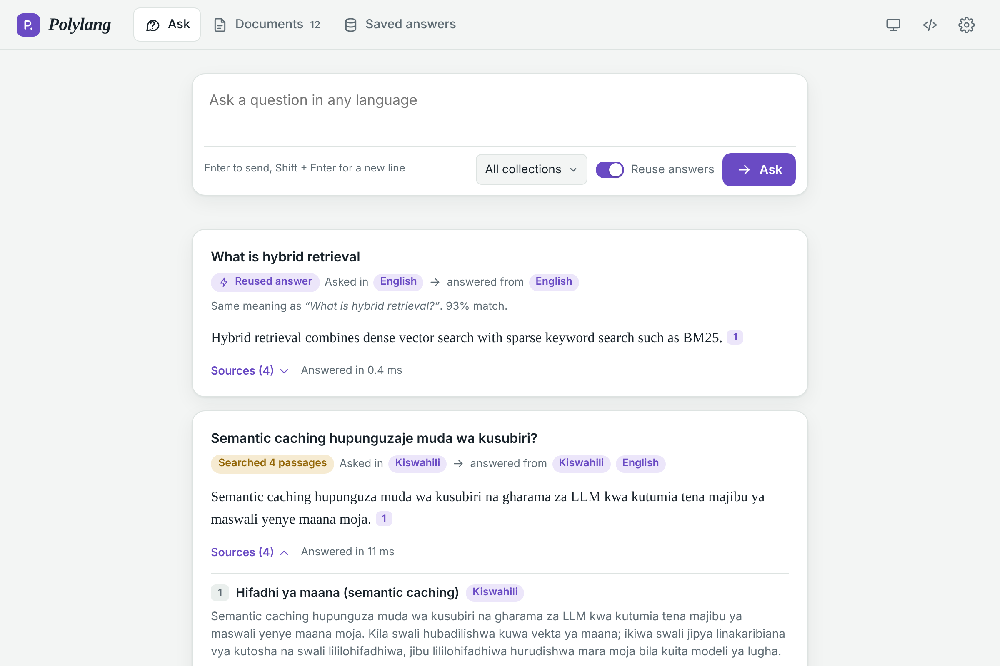
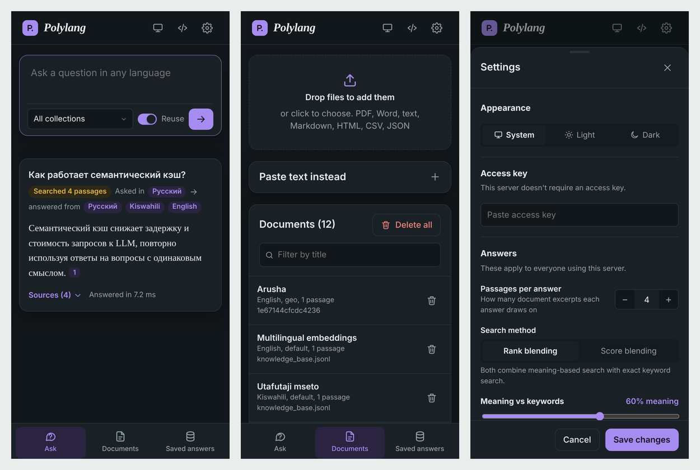
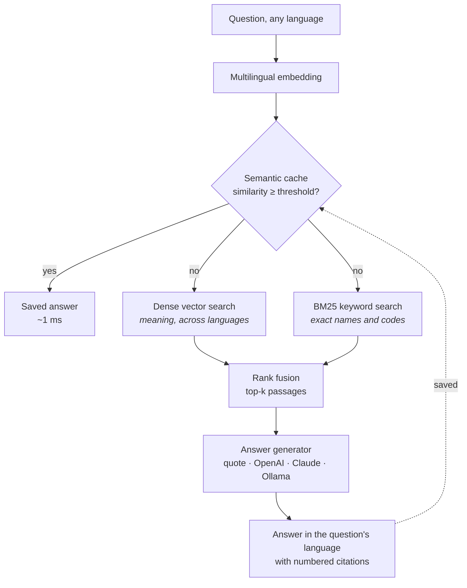

<div align="center">

# Polylang

**Ask in any language. Answer from every language.**

A self-hosted question-answering service for multilingual knowledge bases, with hybrid retrieval
and a cross-lingual semantic cache.

[](https://github.com/valentinakiyungi/polylang/actions/workflows/ci.yml)
[](https://www.python.org/)
[](https://fastapi.tiangolo.com/)
[](#docker)
[](LICENSE)

[Quick start](#quick-start) ·
[Features](#features) ·
[How it works](#how-it-works) ·
[API](#rest-api) ·
[Configuration](#configuration) ·
[Development](#development)

<br>



</div>

---

## Overview

Organisations rarely keep their knowledge in one language. Policies are written in English,
field reports arrive in Kiswahili, partner documents come in French or Russian, and the people
asking questions use whichever language is most natural to them.

Polylang lets you load documents in any language and ask questions in any other. It finds the
relevant passages using multilingual embeddings and keyword search, writes an answer in the
asker's language, and cites the passages it used.

Each answer is also saved in a **semantic cache**. When someone later asks the same thing, in
different words or in a different language, the saved answer is returned in about a millisecond,
with no search and no LLM call.

| Without Polylang | With Polylang |
|---|---|
| A Kiswahili question can't find an English document | Questions and documents meet in one shared, language-independent vector space |
| Every rephrasing of a question costs a full LLM call | Equivalent questions, in any language, reuse one stored answer |
| Keyword search misses paraphrases; vector search misses exact names and codes | Both run together and their rankings are fused |
| Answers can't be traced back to their source | Every answer cites numbered source passages |

## Features

**Retrieval**
- Hybrid search: multilingual dense vectors plus an incremental BM25 index, merged with reciprocal
  rank fusion or a weighted score blend
- Sentence-aligned, overlapping chunking with per-chunk language detection
- Collections, to keep separate knowledge bases on one server and search them independently

**Semantic cache**
- Matches questions by meaning, across languages, using a configurable similarity threshold
- LRU eviction, time-to-live, per-collection scoping and hit-rate statistics
- Cleared automatically whenever documents change, so it never serves stale answers

**Answer generation**
- Works with no LLM at all: the default mode quotes the most relevant sentences with citations
- Optional OpenAI (or any OpenAI-compatible server), Anthropic Claude, or a local Ollama model
- LLM answers are written in the question's language
- If the LLM call fails, the service falls back to a quoted answer and reports a warning

**Ingestion**
- PDF, Word (.docx), plain text, Markdown, HTML, CSV, JSON and JSON Lines
- Upload through the web app or the API, or ingest whole folders from the command line
- Duplicate documents are detected and skipped

**Operations**
- Web app, REST API with interactive docs, Python library and command-line tool
- Everything persists to disk; changing the embedding model triggers automatic re-indexing
- Settings that can be changed while the server runs, from the web app or the API
- Optional access-key authentication, CORS control and upload size limits
- Docker image with the embedding model built in, health check and CI

## Quick start

Requires Python 3.10 or newer.

```bash
git clone https://github.com/valentinakiyungi/polylang.git
cd polylang
python3 -m venv venv && source venv/bin/activate
pip install -e ".[files]"

polylang ingest data/samples/knowledge_base.jsonl   # optional: multilingual sample data
polylang serve
```

Open **http://127.0.0.1:8001** for the web app, or **http://127.0.0.1:8001/docs** for the
interactive API reference.

> [!NOTE]
> The first start downloads the multilingual embedding model (about 470 MB) and PyTorch.
> On a slow connection, see [Offline mode](#offline-mode) to try Polylang in a few seconds
> without either.

### Docker

```bash
cp .env.example .env        # optional
docker compose up --build
```

The service listens on port 8001 and stores its data in the `polylang-storage` volume. The image
already contains the embedding model, so containers start without network access.

To answer with a local LLM instead of quoting, start the bundled Ollama service and pull a model:

```bash
docker compose --profile ollama up -d
docker compose exec ollama ollama pull llama3.1
```

Then set `POLYLANG_LLM_PROVIDER=ollama` and `POLYLANG_LLM_BASE_URL=http://ollama:11434` in `.env`
and restart.

## Usage

### Web app

| | |
|---|---|
| **Ask** | Ask in any language. Each answer shows the question's language, the languages of its sources, whether it was reused from the cache, and clickable citations. |
| **Documents** | Drag in files or paste text. Filter, inspect and delete documents. |
| **Saved answers** | See cached answers, how often each was reused, and the overall reuse rate. |
| **Settings** | Theme, access key, passages per answer, search method, meaning/keyword balance and cache behaviour. |

The layout adapts to phones, with a bottom tab bar and a slide-up settings sheet, and supports
light and dark themes.

<p align="center">
  
</p>

### Command line

```bash
polylang ingest ./handbook ./policies.pdf -c hr      # files or folders, into a collection
polylang query "Je, semantic caching hufanyaje kazi?"
polylang query "How does semantic caching work?"     # reuses the Kiswahili answer
polylang query "What is BM25?" -k 6 --no-cache --json
polylang list -c hr
polylang delete <document-id>
polylang stats
polylang clear-cache
polylang serve --host 0.0.0.0 --port 8001
```

Global options: `--data-dir PATH`, `--offline`, `-v`.

### REST API

| Method | Endpoint | Description |
|---|---|---|
| `POST` | `/query` | Answer a question: cache lookup, then hybrid retrieval and generation |
| `POST` | `/retrieve` | Return ranked passages without generating an answer |
| `POST` | `/documents` | Add one or more documents as JSON |
| `POST` | `/documents/upload` | Upload files (multipart field `files`, optional `collection`) |
| `GET` | `/documents` | List documents, optionally filtered by `?collection=` |
| `GET` | `/documents/{id}` | Get one document with its passages |
| `DELETE` | `/documents/{id}` | Delete a document |
| `DELETE` | `/documents?confirm=true` | Delete all documents |
| `GET` | `/cache` | List saved answers |
| `DELETE` | `/cache` · `/cache/{id}` | Clear the cache, or remove one entry |
| `GET` · `PATCH` | `/config` | Read or change runtime settings |
| `GET` | `/stats` | Index and cache statistics |
| `GET` | `/health` | Liveness check; never requires a key |

Add documents and ask a question:

```bash
curl -X POST http://127.0.0.1:8001/documents \
  -H "Content-Type: application/json" \
  -d '{"collection": "faq",
       "documents": [{"id": "refunds", "title": "Refund policy",
                      "text": "Refunds are issued within 14 days of purchase."}]}'

curl -X POST http://127.0.0.1:8001/query \
  -H "Content-Type: application/json" \
  -d '{"query": "Ninaweza kurudishiwa pesa baada ya siku ngapi?", "collection": "faq"}'
```

<details>
<summary>Example response</summary>

```json
{
  "query": "How does semantic caching work?",
  "language": "en",
  "status": "cache_hit",
  "answer": "Semantic caching reduces LLM latency and cost by reusing answers to questions that mean the same thing. [1]",
  "cache": {
    "entry_id": "3f0c9a1b2d4e",
    "similarity": 0.9312,
    "matched_query": "Je, semantic caching hufanyaje kazi?",
    "matched_language": "sw",
    "hits": 1
  },
  "sources": [
    {
      "rank": 1,
      "chunk_id": "cache-en:0",
      "doc_id": "cache-en",
      "title": "Semantic caching",
      "language": "en",
      "text": "Semantic caching reduces LLM latency and cost ...",
      "score": 0.0328,
      "dense_score": 0.71,
      "sparse_score": 6.2
    }
  ],
  "generator": "extractive",
  "warnings": [],
  "timings_ms": {"embed": 11.4, "cache_lookup": 0.08, "total": 11.6}
}
```

`status` is `cache_hit`, `cache_miss` (answered through retrieval) or `no_context` (nothing
relevant was found).
</details>

### Python

```python
from polylang import RAGEngine, Settings

engine = RAGEngine(Settings.from_env(llm_provider="ollama", llm_model="llama3.1"))
engine.ingest_path("docs/")

result = engine.query("Как работает гибридный поиск?")
print(result.answer)
for source in result.sources:
    print(source.rank, source.title, source.language)
```

## How it works



1. **Embed.** The question is encoded with
   [`paraphrase-multilingual-MiniLM-L12-v2`](https://huggingface.co/sentence-transformers/paraphrase-multilingual-MiniLM-L12-v2),
   which maps text from 50+ languages into one shared vector space.
2. **Check the cache.** A single matrix-vector product compares the question with every saved
   question. Above the threshold, the saved answer is returned immediately.
3. **Retrieve.** Dense search finds passages with the same meaning in any language; BM25 finds
   exact terms that embeddings can blur. Reciprocal rank fusion rewards passages ranked highly
   by either method.
4. **Generate.** The top passages are numbered and passed to the configured generator, which
   answers in the question's language and cites them.
5. **Store.** The answer, its sources and the question's vector are saved in the cache.

Adding or deleting a document clears the cache, because earlier answers may no longer reflect the
knowledge base.

## Configuration

Polylang reads environment variables, or a `.env` file in the working directory. Every setting
is optional; [`.env.example`](.env.example) lists them all.

| Variable | Default | Description |
|---|---|---|
| `POLYLANG_DATA_DIR` | `./storage` | Where documents, vectors, cache and settings are saved |
| `POLYLANG_EMBEDDING_BACKEND` | `sentence-transformers` | Set to `hashing` for [offline mode](#offline-mode) |
| `POLYLANG_EMBEDDING_MODEL` | `paraphrase-multilingual-MiniLM-L12-v2` | Any sentence-transformers model |
| `POLYLANG_CHUNK_SIZE` · `_OVERLAP` | `800` · `120` | Passage size and overlap, in characters |
| `POLYLANG_TOP_K` | `4` | Passages per answer |
| `POLYLANG_FUSION` | `rrf` | `rrf` (rank fusion) or `weighted` (score blend) |
| `POLYLANG_DENSE_WEIGHT` | `0.6` | Balance between meaning (1.0) and keywords (0.0) |
| `POLYLANG_CACHE_ENABLED` | `true` | Reuse earlier answers |
| `POLYLANG_CACHE_THRESHOLD` | `0.88` | Cosine similarity needed to reuse an answer |
| `POLYLANG_CACHE_CROSS_LINGUAL` | `true` | Allow reuse across languages |
| `POLYLANG_CACHE_TTL_SECONDS` | `86400` | How long answers are kept; `0` keeps them indefinitely |
| `POLYLANG_CACHE_MAX_ENTRIES` | `5000` | Least recently used answers are dropped beyond this |
| `POLYLANG_LLM_PROVIDER` | `extractive` | `extractive`, `openai`, `anthropic` or `ollama` |
| `POLYLANG_LLM_MODEL` | provider default | For example `gpt-4o-mini`, `claude-haiku-5-5`, `llama3.1` |
| `POLYLANG_LLM_BASE_URL` | provider default | For OpenAI-compatible servers and Ollama |
| `POLYLANG_LLM_API_KEY` | — | Falls back to `OPENAI_API_KEY` or `ANTHROPIC_API_KEY` |
| `POLYLANG_API_KEY` | — | When set, requests must send it in the `X-API-Key` header |
| `POLYLANG_MAX_UPLOAD_MB` | `25` | Maximum size per uploaded file |
| `POLYLANG_CORS_ORIGINS` | `*` | Comma-separated list of allowed origins |

Passages per answer, search method, meaning/keyword balance and all cache settings can also be
changed while the server runs, from **Settings** in the web app or with `PATCH /config`. Those
changes are saved to `settings.json` in the data directory and take precedence over environment
variables.

### Tuning the cache

A higher threshold is safer; a lower one saves more LLM calls. With the default model, 0.85–0.90
works well for paraphrases, and the same question in two languages typically scores 0.85–0.95.
Watch the reuse rate on the **Saved answers** page and adjust.

A cross-language cache hit returns the saved answer as it was written. If an English question
matches an answer generated for a Kiswahili question, the answer is in Kiswahili, and
`cache.matched_language` says so. Set `POLYLANG_CACHE_CROSS_LINGUAL=false` if answers must always
be in the asker's language.

### Offline mode

`POLYLANG_EMBEDDING_BACKEND=hashing`, or `--offline` on the command line, replaces the neural
model with a character n-gram hashing embedder that needs only NumPy:

```bash
pip install --no-deps -e .
pip install numpy pydantic fastapi "uvicorn[standard]" python-multipart pypdf python-docx
polylang --offline ingest data/samples/knowledge_base.jsonl
polylang --offline serve
```

Everything works, but matching is by spelling rather than meaning, so it is **not cross-lingual**.
It is intended for trying Polylang quickly, for CI, and for machines without PyTorch. Data indexed
in offline mode is re-indexed automatically the first time the full model is used.

## Production notes

- **Authentication.** Set `POLYLANG_API_KEY` and put the service behind HTTPS (a reverse proxy
  such as Caddy or nginx). Restrict `POLYLANG_CORS_ORIGINS` to your own domains.
- **Persistence.** Mount the data directory on durable storage. Documents and indexes are written
  to a temporary file first and then swapped in, so an interrupted write doesn't corrupt them.
- **Scale.** The vector and keyword indexes live in memory and are searched exactly. This is
  fast up to roughly a few hundred thousand passages on one machine. Run a single worker
  process per data directory.
- **Models.** Larger multilingual models, such as `paraphrase-multilingual-mpnet-base-v2`, improve
  retrieval quality at the cost of speed and memory. Changing `POLYLANG_EMBEDDING_MODEL`
  re-indexes existing documents on the next start.

## Development

```bash
pip install -e ".[files,dev]"
pytest                          # runs fully offline
ruff check polylang tests
```

```
polylang/
├── engine.py         Orchestration: ingest, retrieve, cache, generate, persist
├── cache.py          Cross-lingual semantic cache
├── bm25.py           Incremental BM25 index
├── vector_store.py   Dense vector index
├── embeddings.py     Sentence-transformers and offline hashing embedders
├── llm.py            Extractive, OpenAI, Anthropic and Ollama generators
├── chunking.py       Sentence-aligned chunking
├── loaders.py        File parsers
├── text.py           Tokenisation and language detection
├── config.py         Settings
├── api.py            FastAPI routes
├── server.py         ASGI entry point
├── cli.py            Command-line interface
└── static/           Web app
tests/                Test suite
data/samples/         Multilingual sample knowledge base
docs/images/          Screenshots
```

## Contributing

Issues and pull requests are welcome. Before opening a pull request, please make sure
`pytest` and `ruff check polylang tests` pass, and add tests for new behaviour.

## Acknowledgements

Polylang builds on [sentence-transformers](https://www.sbert.net/),
[FastAPI](https://fastapi.tiangolo.com/) and [NumPy](https://numpy.org/).

## License

Released under the [MIT License](LICENSE).
